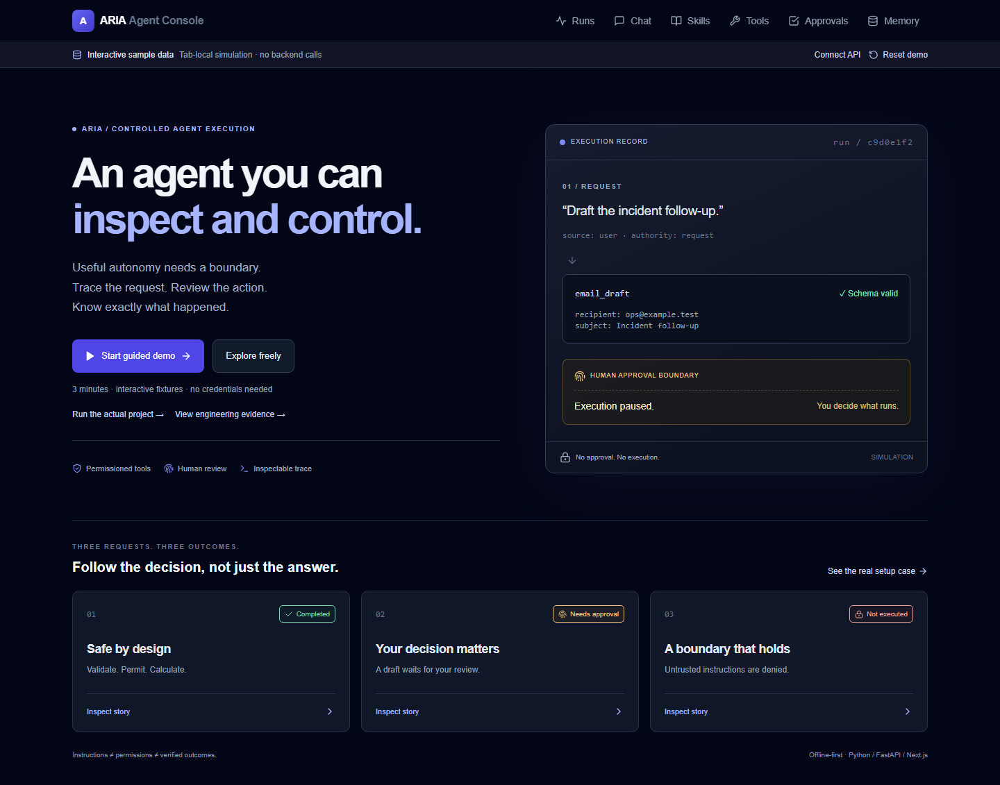

# ARIA — an agent you can inspect and control

Follow a request through permission, human review and execution. ARIA pairs a
visual recruiter demo with a real Python harness whose approvals bind exact
actions and admit a single execution claim.

**Try the preview:** `cd frontend`, `npm ci`, `npm run demo:ui`, then open
`http://localhost:3000`. Start the guided demo or explore the calculation,
review-required draft and denied-action stories. Every screen labels its
interactive sample data; reset restores the scenario. No credentials required.

**Inspect the engineering:** [case study](docs/portfolio-case-study.md) ·
[walkthrough and real API setup](docs/portfolio-walkthrough.md) ·
[coding-agent setup fixture](examples/coding_agent_setup/README.md) ·
[baseline](docs/portfolio-baseline.md) · [verification](docs/portfolio-verification.md).

**Run the connected application:** [strict SQLite setup and review path](docs/portfolio-connected.md).
Connected Chat, Runs, Skills, Approvals and Memory share a selected session and
saved execution evidence. Five shipped skills match automatically; the Skills
view explains selection and preserves the exact historical instructions.

The setup fixture has credential-free protocol tests and a reproducible native
benchmark runner. Native Claude Code trials remain unavailable; no model-quality
improvement is claimed. The preview simulates actions; Python tests execute actual
local tools and API/store paths.



Local verification results and the separate sample/real-process browser gates
are recorded in the dated
[verification record](docs/portfolio-verification.md) for commands and limits.


ARIA is an offline-first agent harness for demonstrating controlled execution.
The default demo uses deterministic routing, local tools, in-memory state, and
no credentials or network. PostgreSQL, Redis, Celery, and real model providers
are optional integration surfaces; none is required to run the suite.

## What is shipped

- Schema-validated tools with `safe` and `requires_approval` permissions.
- A compatibility-preserving `AriaAgent.run()` string API and structured
  `RunResult` API.
- A bounded single-hop default and opt-in deterministic multi-hop plan mode.
- Deterministic safety classification (`off`, `warn`, `block`), injectable retry
  policies, and fixed-window per-session/tool rate limiting.
- Approval queues with lazy expiry, an optional local sweeper, and the existing
  Celery sweep task.
- Immutable action/run/expiry binding, atomic execution claims in memory and SQL,
  durable no-retry outcomes after uncertain execution, and a strict launch profile.
- AgentTrace-compatible spans, cost summaries, replay with dry-run default, and
  ordered SSE events at `POST /agent/chat/stream`.
- A pure-Python hashed-vector memory index at `GET /agent/memory/search`.
- Five packaged API skills with automatic matching, explicit overrides and
  immutable per-run evidence; explicit library activation defaults preserved.
- Session-isolated conversation history and durable approval outcome recovery.
- A self-contained vendored compatibility subset under
  `src/aria/internal/vendor_core/`, pinned and attributed in
  `THIRD_PARTY_NOTICES.md`.
- A reproducible offline evidence bundle and golden fixture.
- A visual tour with explicit sample/connected providers; connected outages
  remain errors with Retry and an explicit switch to sample data.

## Quick start

```bash
python -m venv .venv
# Windows: .venv\Scripts\activate
# macOS/Linux: source .venv/bin/activate
python -m pip install -e ".[dev]"
python examples/run_demo.py
python scripts/portfolio_demo.py
python scripts/verify_portfolio_evidence.py
uvicorn aria.main:app --reload --app-dir src
```

The canonical install path is `pip install -e ".[dev]"`. Docker Compose is
optional and only starts PostgreSQL and Redis for integration work.

## Offline evidence path

`make evidence` runs a fixed SQLite-free scenario covering routing, bounded
multi-hop execution, safety decisions, retries, rate limits, approval state,
dry-run replay, streaming event order, local memory ranking, costs, and traces.
The generated bundle lives under ignored `artifacts/portfolio/aria-agent-evidence`.
It contains `manifest.json`, canonical `report.json`, `report.md`,
`strict-profile.json` measuring authorization/denial/single-use/replay effects,
and `checksums.sha256`; `scripts/verify_portfolio_evidence.py` rejects tampering,
missing files, malformed manifests, and golden-result drift.

Secrets are redacted by key and by common bearer/API-key patterns. Timestamps,
runtime durations, generated IDs, and environment paths are excluded from the
reproducibility hash, while the raw report remains inspectable locally.

## API surface

For the controlled demonstration, set `AGENT_MODE=approval_gated` and
`ARIA_SAFETY_MODE=block` before launch. Defaults remain compatible. Existing SQL
databases require `alembic upgrade head`; old unbound approvals require fresh
review. A committed claim is never retried automatically after a crash;
reconcile the outcome first. See [security](docs/security.md).

| Method | Path | Purpose |
|---|---|---|
| POST | `/agent/chat` | Run the agent and return the legacy-compatible structured result |
| POST | `/agent/chat/stream` | Stream ordered reasoning, decision, approval, tool, error, and completion events as SSE |
| GET | `/agent/runs` | List recent persisted or in-memory runs |
| GET | `/agent/runs/{id}` | Fetch a run with trace and cost |
| GET | `/skills?session_id=default&run_id=...` | Inspect current catalog and selected saved skill evidence |
| GET | `/agent/memory?session_id=default&limit=50` | Read actual session conversation memory |
| POST | `/agent/runs/{id}/replay` | Replay a trace; dry-run is the default |
| GET | `/agent/memory/search` | Inspect deterministic local memory matches |
| GET/POST | `/approvals...` | Inspect and decide approval-queue records; optional `/approvals/sweep` |
| GET | `/tools...` | Inspect registered tools and schemas |
| GET | `/health` | Report dependency health and safe execution/routing/persistence capabilities |

Existing response keys, route vocabulary, approval lifecycle, cost numbers, and
trace span vocabulary remain stable. New execution metadata is additive.

## Development gates

```bash
pytest -q
pytest --noconftest tests/test_skills.py -q
ruff check src/aria tests examples scripts
ruff format --check src/aria tests examples scripts
pyright src/
make evidence
make package
make forbidden

cd frontend
npm ci
npm test -- --run
npm run lint
npm run build
npx playwright install chromium
npm run test:e2e -- --project=chromium
npm run test:e2e:connected -- --project=chromium
npm run test:e2e:prod -- --project=chromium
npm run test:e2e -- --config playwright.live.config.ts --project=chromium
# From the repository root after the real-process browser suite:
# python scripts/verify_connected_evidence.py
```

### Verified snapshot — 2026-08-14

| Surface | Fresh result |
|---|---|
| Python suite | 200 passed |
| Focused progressive-disclosure skills | 12 passed (focused subset, not added to 200) |
| Ruff | Check passed; 72 files format-clean |
| Pyright | 0 errors |
| Evidence | Generated and verified against the golden fixture |
| Package | sdist/wheel built; vendored wheel contents verified |
| Frontend | 31 Vitest tests, lint, and production build passed |
| Browser smoke | 6 passed locally in Chromium (reverified 2026-08-15) |

On this Windows host the default global pytest temp directory was inaccessible;
the full suite passed with `--basetemp=.pytest-temp/plan-run`. The Playwright
Chromium smoke suite was re-run locally on 2026-08-15 with all six tests passing.
The CI workflow installs Chromium explicitly before running the same suite.

That snapshot is historical. Current milestone results and environment limits
are in [the verification record](docs/portfolio-verification.md). The dashboard
now has interactive synthetic scenario state alongside its connected routes.

## Portfolio UI demo

The frontend ships a **forced demo mode** for portfolio walkthroughs — no backend,
credentials, provider service or network font required. It runs on its local
frontend server. Skills disclose only when activated and do not grant permissions.

```bash
cd frontend
npm ci
npm run demo:ui
```

Open `http://localhost:3000`. Every view reads bundled sample data immediately
(`NEXT_PUBLIC_DEMO_MODE=true`). The persistent **Interactive sample data** toolbar
identifies the simulation and offers reset.

**Click path:**

1. **Start guided demo** — safe calculator with request-to-execution timeline.
2. **Draft review** — reject, reset and approve the exact action once; nothing is sent.
3. **Denied action** — repository text cannot grant an unavailable tool permission.
4. **Skills** — activated calculator content differs from the catalog.
5. **Setup case** — actual project workflow, engineering evidence and native limits.

For a live API, follow the [strict launch and connected workflow](docs/portfolio-walkthrough.md),
including the explicit local CORS origin. Outages remain visible errors until
Retry or an explicit sample switch.

## Boundaries

The repository deliberately does not require hosted/team tenancy, notification
webhooks, external vector services, OTLP protobuf/gRPC, mandatory Redis or
PostgreSQL, or provider credentials. Those are product directions, not hidden
dependencies. Local abstractions are present so the execution core and its
evidence can be reviewed without infrastructure.

## Project map

- `src/aria/internal/core/` — canonical execution contracts and policies.
- `src/aria/agents.py`, `routing.py`, `tools.py`, `approvals.py`, `memory.py` —
  compatibility facades retained for existing integrations.
- `src/aria/internal/vendor_core/` — attributed, pinned local compatibility
  modules used by the server and worker.
- `scripts/` — evidence generation, verification, wheel, and dependency scans.
- `tests/fixtures/golden/portfolio-evidence.json` — normalized offline proof.
- `frontend/` — dashboard with unit, lint, build, and browser smoke coverage.
- `docs/` — architecture, security, replay, streaming, safety, memory, and
  evidence notes.

## Part of the stack

[groundtruth](https://github.com/FishRaposo/groundtruth) · [evalforge](https://github.com/FishRaposo/evalforge) · [llm-gateway](https://github.com/FishRaposo/llm-gateway) · [agenttrace](https://github.com/FishRaposo/agenttrace) · [WCP-Compliance-Agent-V5](https://github.com/FishRaposo/WCP-Compliance-Agent-V5)

## License

MIT. See [LICENSE](LICENSE) and [THIRD_PARTY_NOTICES.md](THIRD_PARTY_NOTICES.md).
